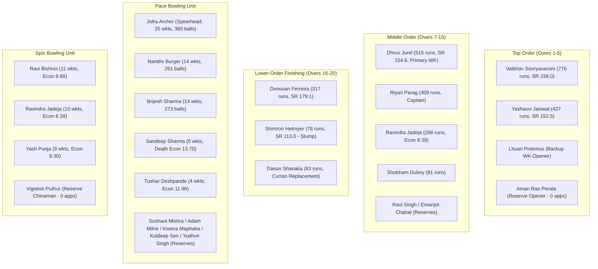

# RR IPL 2026 Squad Depth & Structural Analysis

## 1. Squad Depth Hierarchy by Role

---

## 2. Quantitative Depth & Vulnerability Assessment

### A. Top-Order Batting: Elite Surplus (Grade: A+)
- **Primary Pair:** Vaibhav Sooryavanshi (LHB) + Yashasvi Jaiswal (LHB).
- **Aggregate Output:** 1,203 runs scored in 16 matches at a tournament-leading Powerplay strike rate of 187.33.
- **Reserves:** Aman Rao Perala (domestic List-A double-centurion) and Lhuan Pretorius.
- **Diagnosis:** No recruitment needed. Any high-cost investment in top-order openers at the 2027 auction would represent redundant capital allocation.

### B. Wicketkeeping: Strong Core, Thin Bench (Grade: B+)
- **Primary:** Dhruv Jurel (16 matches as wicketkeeper, 515 runs at 154.65 SR).
- **Secondary:** Donovan Ferreira (emergency gloveman capability).
- **Tertiary:** Lhuan Pretorius (overseas slot required).
- **Diagnosis:** Dhruv Jurel's emergence as an elite Indian wicketkeeper-batter solves the starting XI role, but RR lacks an Indian domestic backup keeper if Jurel suffers an injury.

### C. Lower-Order Finishing: Critical Failure Point (Grade: D)
- **Primary Contributor:** Donovan Ferreira (317 runs, SR 179.10).
- **The Breakdown:** Shimron Hetmyer plummeted to an average under 14 and strike rate of 113.04 across 7 innings; Sam Curran was ruled out before the season began; Dasun Shanaka struck at just 136.96.
- **Diagnosis:** Tail was exposed in 11 matches, losing wickets at an alarming rate of 10.94 balls per dismissal in overs 17–20. Acquiring a dedicated right-handed pace hitter (#6/#7) is an urgent priority.

### D. Pace Bowling: Top-Heavy & Fragile (Grade: C+)
- **Pace Burden:** Jofra Archer (360 balls), Brijesh Sharma (273 balls), and Nandre Burger (261 balls) bowled 894 out of 988 total pace deliveries (90.5%).
- **Death Concession:** Sandeep Sharma (13.70 rpo) and Tushar Deshpande (12.38 rpo) could not contain opposition hitters in overs 18–20.
- **Overseas Reliance:** Two of the top three pacers (Archer and Burger) consumed overseas slots, while Adam Milne and Kwena Maphaka sat on the bench.
- **Diagnosis:** RR must recruit an express death-bowling specialist (>145 km/h yorker execution) and an Indian domestic pace asset to release overseas slots for finishing power.

### E. Spin Bowling: Controlled but Lacks Middle Choke (Grade: B)
- **Personnel:** Ravi Bishnoi (11 wickets), Ravindra Jadeja (10 wickets), Yash Punja (9 wickets).
- **Limitation:** While Jadeja provided steady containment (Econ 8.39), Bishnoi and Punja both conceded over 9.30 rpo against aggressive middle-overs boundary hitters.
- **Diagnosis:** Secondary need for an off-spin / finger-spin run container against opposing left-handers in overs 7–12.

