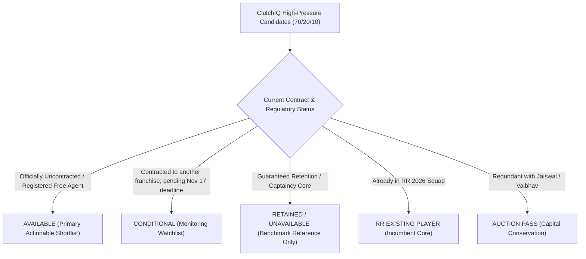

# IPL 2027 Auction Availability Audit & Target Filtering Report

**Date of Audit:** November 11, 2026  
**Regulatory Context:** IPL 2027 Player Retention Deadline is **November 17, 2026** (6 days away).  
**Franchise:** Rajasthan Royals (`team_id=3`)  
**Audit Purpose:** Filter the ClutchIQ pressure rankings through an empirical availability lens to prevent Rajasthan Royals from basing their auction strategy on players who are unavailable, retained by other franchises, or already on RR's roster.

---

## 1. Availability Taxonomy & Governing Principles

In compliance with **TASK 11.4**, all prospective targets are audited under a strict 5-tier classification:

### Core Integrity Safeguards
1. **Preservation of Performance Scores:** ClutchIQ integrated pressure scores, V3 ratings, and reliability tiers remain 100% untouched. Availability acts as a **pragmatic tactical filter**, not a metric modifier.
2. **No Pre-Emptive Retention Assumptions:** Because today is November 11, 2026, and the official retention deadline is November 17, 2026, **no player contracted to another IPL 2026 team is treated as guaranteed available**. All such players are placed in the **Conditional Monitoring Watchlist**.
3. **Confirmed Free Agents as Primary Targets:** Only players with verified uncontracted status in the official registration registry form the primary actionable shortlist.

---

## 2. Primary Actionable Shortlist (Verified Available Targets)

### A. Final Available Batter Targets
These players are officially uncontracted free agents, hold strong pressure ratings, and solve **W2 (Lower-Order Finishing Collapse & Tail Exposure)**:

| Rank | Player | Nat. | Role | ClutchIQ Score | Evidence Tier | 2026 Status | Tactical Role for RR | Available Alternative | Best Conditional Target |
|:---:|:---|:---:|:---|:---:|:---:|:---|:---|:---|:---|
| **1** | **Glenn Maxwell** | AUS | Power Finisher & Off-Spinner | **63.40** | Strong ($\ge 150$ HP) | Free Agent | #5/#6 spin counter-attacker; 2 PP overs vs LHBs. | Andre Russell | Tim David (RCB) |
| **2** | **Harry Brook** | ENG | Middle Accelerator (#5) | **61.63** | Moderate (40–149) | Free Agent | 360-degree boundary striker against high pace. | Rilee Rossouw | Naman Dhir (MI) |
| **3** | **Andre Russell** | WI | Power Finisher & Seamer | **58.68** | Strong ($\ge 150$ HP) | Free Agent | #7 death power striker; heavy seam overs. | Glenn Maxwell | Ashutosh Sharma (DC) |
| **4** | **Rilee Rossouw** | SA | Middle Boundary Striker | **63.61** | Moderate (40–149) | Free Agent | Aggressive pace hitter during middle squeeze overs. | Daryl Mitchell | Rajat Patidar (RCB) |
| **5** | **Jonny Bairstow**| ENG | Aggressive Batter / WK | **58.05** | Moderate (40–149) | Free Agent | Experienced pressure middle batter; backup keeper. | Shai Hope | Heinrich Klaasen (SRH) |
| **6** | **Daryl Mitchell**| NZ | Crisis Stabilizer (#4/#5) | **56.46** | Strong ($\ge 150$ HP) | Free Agent | Elite running and spin manipulation during collapses. | Glenn Phillips | Glenn Phillips (GT) |

### B. Final Available Bowler Targets
These players are officially uncontracted free agents with proven pressure execution, directly solving **W1 (Acute Death Bowling Concession: 13.70 rpo by Sandeep Sharma)**:

| Rank | Player | Nat. | Bowling Style | ClutchIQ Score | Evidence Tier | 2026 Status | Tactical Role for RR | Available Alternative | Best Conditional Target |
|:---:|:---|:---:|:---|:---:|:---:|:---|:---|:---|:---|
| **1** | **Mark Wood** | ENG | Right-arm Fast (>150 km/h) | **73.89** | Moderate (25–99) | Free Agent | Express enforcer; overs 18 & 20 partner for Jofra Archer. | Naveen ul Haq | Matheesha Pathirana (KKR) |
| **2** | **Naveen ul Haq**| AFG | Fast-Medium (Death Variations)| **59.09** | Moderate (25–99) | Free Agent | Specialized wide yorkers and dipping off-cutters. | Tim Southee | Nathan Ellis (CSK) |
| **3** | **Joshua Little** | IRE | Left-Arm Fast-Medium | **61.81** | Moderate (25–99) | Free Agent | Left-arm angle enforcer in middle & death overs. | Jason Behrendorff | Mohsin Khan (LSG) |
| **4** | **Jason Behrendorff**| AUS | Left-Arm Medium-Fast | **56.65** | Moderate (25–99) | Free Agent | Restrictive Powerplay swing; allows Archer to hold overs. | Tim Southee | Josh Hazlewood (RCB) |
| **5** | **Tim Southee** | NZ | Fast-Medium (Wide Yorkers) | **58.10** | Moderate (25–99) | Free Agent | Veteran death composure and tactical leadership. | Mark Wood | Nathan Ellis (CSK) |

---

## 3. Conditional Targets Monitoring Watchlist (Awaiting Nov 17 Deadline)

These players hold elite ClutchIQ ratings and represent ideal tactical fits, but are **currently contracted to rival franchises**. RR scouts must track the official BCCI retention releases on November 17:

1. **Matheesha Pathirana (KKR &bull; Bowler &bull; Score: 66.37):** Prime #1 overall bowling target. If KKR releases him due to overseas retention constraints, RR must aggressively pursue him for overs 18 & 20. *Contingency: Mark Wood.*
2. **Tim David (RCB &bull; Batter &bull; Score: 70.67):** Prime #1 overall finishing target (497 HP balls). If RCB does not retain him, RR should bid heavily to replace Shimron Hetmyer. *Contingency: Glenn Maxwell.*
3. **Naman Dhir (MI &bull; Batter &bull; Score: 68.69):** Top domestic finishing target. Unlocks an overseas slot for bowling. *Contingency: Harry Brook.*
4. **Nathan Ellis (CSK &bull; Bowler &bull; Score: 62.66):** High-discipline death bowler. *Contingency: Naveen ul Haq.*
5. **Mohsin Khan (LSG &bull; Bowler &bull; Score: 62.34):** Elite domestic left-arm death asset. *Contingency: Joshua Little.*
6. **Sunil Narine (KKR &bull; Bowler &bull; Score: 64.48):** Premier finger-spin run container. *Contingency: Glenn Maxwell (off-spin utility).*
7. **Heinrich Klaasen (SRH &bull; Batter &bull; Score: 63.07):** Elite spin bludgeoner. Very high retention probability; opportunistic contingency only.

---

## 4. Retained Cores, Benchmark References & Disciplined Passes

- **Jasprit Bumrah (MI &bull; Score: 61.80):** 100% guaranteed MI core retention. Excluded from auction pursuit; retained in ClutchIQ strictly as an **analytical benchmark** for evaluating yorker execution.
- **Suryakumar Yadav (MI &bull; Score: 66.69):** MI captaincy asset; unavailable.
- **Vaibhav Sooryavanshi (RR &bull; Score: 81.83, #1) & Jofra Archer (RR &bull; 25 wickets):** Existing RR squad members.
- **Priyansh Arya (PBKS &bull; Score: 72.15) & Abhishek Sharma (SRH &bull; Score: 70.87):** **DISCIPLINED AUCTION PASSES**. Redundant top-order left-handers. Bidding on them would deplete purse needed for death bowling.

---

## 5. Summary Audit Matrix (Answers to 5-Point Quality Test)

| Target Profile | Available Primary Target | Verification Source | Weakness Solved | Pressure Evidence | Best Conditional Alternative |
|:---|:---|:---|:---|:---|:---|
| **Express Death Bowler** | **Mark Wood** (ENG) | Free Agent Registry | W1: Death Leakage | Score: 73.89, 76.9% Consistency | Matheesha Pathirana (KKR) |
| **Death Yorker Specialist**| **Naveen ul Haq** (AFG) | Free Agent Registry | W1: Death Concession | Score: 59.09, 31 HP balls | Nathan Ellis (CSK) |
| **High-Pressure Finisher** | **Glenn Maxwell** (AUS) | Free Agent Registry | W2: Finishing & W3: Off-Spin| Score: 63.40, 228 HP balls | Tim David (RCB) |
| **Pace-Hitting Accelerator**| **Harry Brook** (ENG) | Free Agent Registry | W2: Middle Squeeze | Score: 61.63, 113 HP balls | Naman Dhir (MI) |
| **Death Power Hitter** | **Andre Russell** (WI) | Free Agent Registry | W2: Tail Collapse | Score: 58.68, 344 HP balls | Ashutosh Sharma (DC) |
| **Wicketkeeper Cover** | **Jonny Bairstow** (ENG)| Free Agent Registry | W2 & W5: WK Depth | Score: 58.05, 80 HP balls | Heinrich Klaasen (SRH) |

